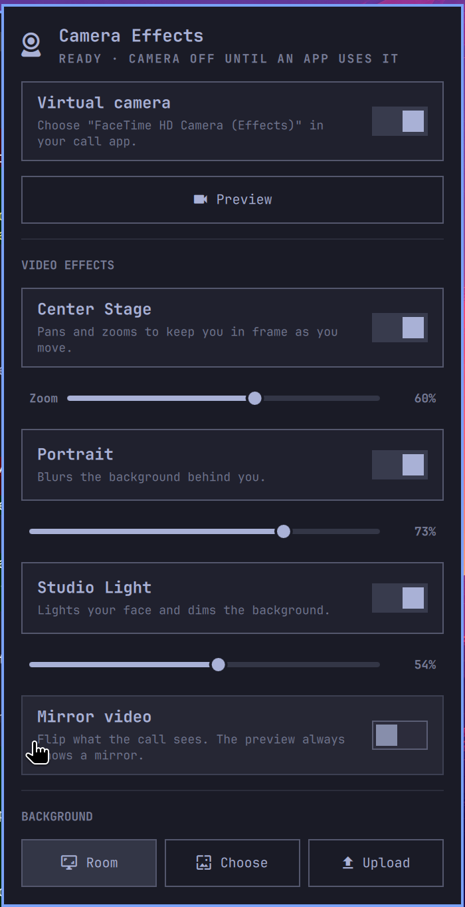

# Camera Effects for Omarchy

Mac-style camera effects for Omarchy, served as a virtual camera that any app
can use: Meet, Zoom, Slack, Teams, OBS.



- **Center Stage**: pans and zooms to keep you in frame. It frames from the
  full 4:3 sensor, and the zoom level is adjustable.
- **Portrait**: background blur, with adjustable strength.
- **Studio Light**: lights your face and dims the room.
- **Background**: replace the room with an uploaded image or a theme background.
- **Mirror video**: flips what the call sees. The preview is always a mirror.

The real camera turns on only while an app has the virtual camera open, so
the camera light behaves like it does on a Mac.

Built and tested on an M1 Pro MacBook running Asahi Linux with Omarchy. It runs
on the CPU at about 26 fps with every effect on.

## Install

```sh
omarchy plugin add https://github.com/sanG-github/omarchy-camera-effects.git --enable
```

Then open the camera icon in the bar and click **Set up the virtual camera**,
or run `~/.config/omarchy/plugins/camera-effects/install.sh`.

The installer:

- installs `v4l2loopback-dkms` and creates `/dev/video42` (this step asks for sudo)
- sets up a Python venv with onnxruntime and OpenCV
- downloads the models
- enables the `camera-effects` user service
- adds the bar widget

In your call app, pick **FaceTime HD Camera (Effects)** as the camera.

## Uninstall

```sh
~/.config/omarchy/plugins/camera-effects/uninstall.sh   # --purge also removes settings and backgrounds
omarchy plugin remove camera-effects
```

The uninstaller stops and removes the service, the venv and the models, and
the module config. It leaves the `v4l2loopback-dkms` package installed.

## Use

Click the bar icon to open the panel. Right-click it to start or stop the
virtual camera. From a terminal:

```sh
camera-effects preview                  # open/close a live preview window
camera-effects toggle portrait          # centerStage | portrait | studioLight | mirror
camera-effects set centerStageZoom 0.8  # 0 wide .. 1 close-up
camera-effects background upload        # add images with the file chooser
camera-effects background choose        # pick from the library and theme backgrounds
camera-effects background none
camera-effects status
camera-effects doctor
```

Settings live in `~/.config/camera-effects/config.json`. The daemon picks up
changes while it runs.

## How it works

`camera-effects daemon` keeps feeding the loopback device, so apps can always
list the virtual camera. It watches `/proc` for other processes that open the
device. When it finds one, it starts the real camera in its full-sensor
NV12 mode through `v4l2-ctl` and runs this pipeline on each frame:

1. **Faces**: [YuNet](https://github.com/opencv/opencv_zoo/tree/main/models/face_detection_yunet).
2. **Framing**: a virtual camera operator. It has a dead zone so the shot holds
   still while you talk, and eased moves so changes look like camera moves.
3. **Matting**: [Robust Video Matting](https://github.com/PeterL1n/RobustVideoMatting).
   It carries state from frame to frame, so hair edges stay stable. It runs on
   the next frame while the current one renders.
4. **Effects**: one float pass over the frame.

## Credits

The models are YuNet (OpenCV Zoo, MIT) and Robust Video Matting (GPL-3.0),
both downloaded at install time.

## License

MIT
